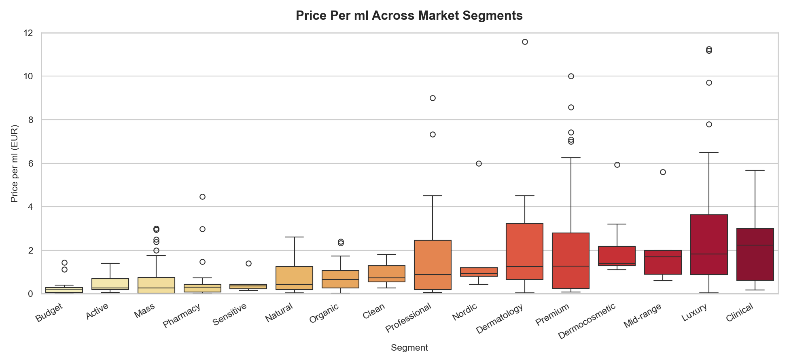
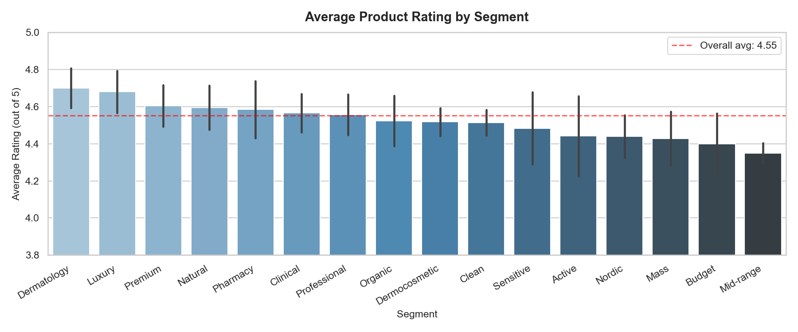
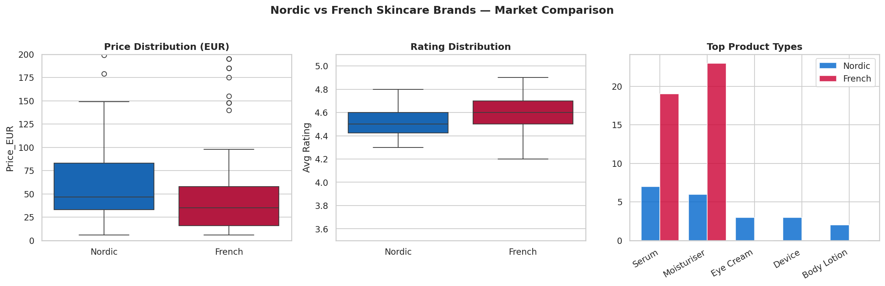

# 🧴 Skincare Market Analysis

**What does a higher price actually buy you in skincare?**
An end-to-end data analysis of **482 skincare products from 210 brands across 27 countries**: collecting and enriching the data through the Open Beauty Facts API, cleaning it with pandas, analysing it in a Jupyter notebook and presenting it in an interactive Streamlit dashboard.

**Tools:** Python · pandas · NumPy · matplotlib · seaborn · Plotly · Streamlit · REST APIs · fuzzy matching (difflib)

---

## Key findings

### 1. Price per ml varies roughly 10× between segments
Median price per ml ranges from **€0.22 (Budget)** to **€2.23 (Clinical)**. Luxury (€1.83) and Mid-range (€1.70) sit near the top, while Pharmacy products stay close to budget levels at €0.30/ml.



### 2. …but ratings barely move
Average ratings only span **4.35 to 4.70** across all segments. Budget products average 4.40 and Luxury 4.68, so paying about 8× more per ml buys roughly a quarter of a star. Mid-range products are rated *lowest* (4.35), despite being among the most expensive per ml.



### 3. "Fragrance-free" claims hold up
I cross-checked every product's marketing claims against its INCI ingredient list. **None of the 158 products claiming to be fragrance-free list parfum/fragrance** in their ingredients. Meanwhile, 22 products that make no claim do contain fragrance.


### 4. Nordic brands cost more, French brands rate higher
Nordic brands (n = 38) have a median price of **€46.50**, compared with **€35** for French brands (n = 107). Yet French brands score slightly higher (median rating 4.6 vs 4.5). French brands focus heavily on moisturisers and serums.



### 5. Best-value sunscreens
A ranking of the 20 cheapest sunscreens by price per ml, a practical shortlist for value-conscious buyers.


---

## Interactive dashboard

`skincare_dashboard.py` is a Streamlit app for exploring the dataset yourself. The public version runs on a **200-product sample** (`demo_sample.xlsx`, covering all 15 most-listed brands and every segment). The full dataset is only used locally:

- **Filters:** searchable brand and key-ingredient dropdowns, product type, segment, skin concern and type, brand country, price range, fragrance-free and alcohol-free toggles
- **Compare:** segment mix, top product types, skin concern × segment heatmap, brands by country
- **Price analysis:** price distribution, median price by type, price vs rating, best value per ml
- **Ratings:** average by segment, top-rated products (min. 5,000 reviews), most-reviewed brands
- **Ingredients:** fragrance claims vs INCI, most common key ingredients, vegan/cruelty-free/organic claims
- **Product table:** sortable, filterable, downloadable as CSV

```bash
pip install -r requirements.txt
streamlit run skincare_dashboard.py
```
The app opens at `http://localhost:8501`. It expects `Skincare_Products_Complete.xlsx` (not included, see the note below) in the same folder.

---

## Data pipeline
> **Note:** the dataset itself is kept private and isn't included in this repository. The code, analysis and charts are shared. To run the notebook or dashboard, use your own data with the same columns (Brand, Product Name, Product Type, Segment, Skin Concern, Free-From / Claims, Price (approx), Size, Avg Rating, INCI (partial), Country of Brand).


| Step | File | What it does |
|---|---|---|
| Collect | `main.py` | Pulls moisturiser data from the Open Beauty Facts API → `moisturizers.csv` |
| Dataset | `Skincare_Products_Complete.xlsx` | Main dataset: 482 products with brand, type, segment, skin concern, claims, price, size, rating and partial INCI |
| Clean | `DataCleaning.py` | Cleans and standardises the dataset → `moisturizer_data.csv` |
| Enrich | notebook, part 2 | Looks up full ingredient lists via the Open Beauty Facts API, with fuzzy matching on product names as a fallback → `Skincare_Products_Complete_updated.xlsx` |
| Parse | notebook, part 2 | Splits ingredient lists and flags fragrance, alcohol, niacinamide and silicones → `skincare_parsed.xlsx` |
| Analyse | `skincare_market_analysis.ipynb` | Charts and findings above |
| Present | `skincare_dashboard.py` | Interactive Streamlit dashboard |

## Limitations
- Prices are approximate retail prices in EUR, and ratings come from aggregated review data, so treat them as indicative.
- The fragrance check uses a *partial* INCI list, so fragrance listed later in an ingredient list could be missed.
- Open Beauty Facts is community-maintained: the exact-name search matched 52 products, and fuzzy matching recovered another 80, giving **132 of 482 (27%)** with full ingredient data. Ingredient-level findings therefore cover a subset of the dataset.

## Next steps
- Deploy the dashboard on [Streamlit Community Cloud](https://share.streamlit.io) for a live link
- Raise ingredient coverage by looking products up by barcode
- Model which product attributes best predict rating
