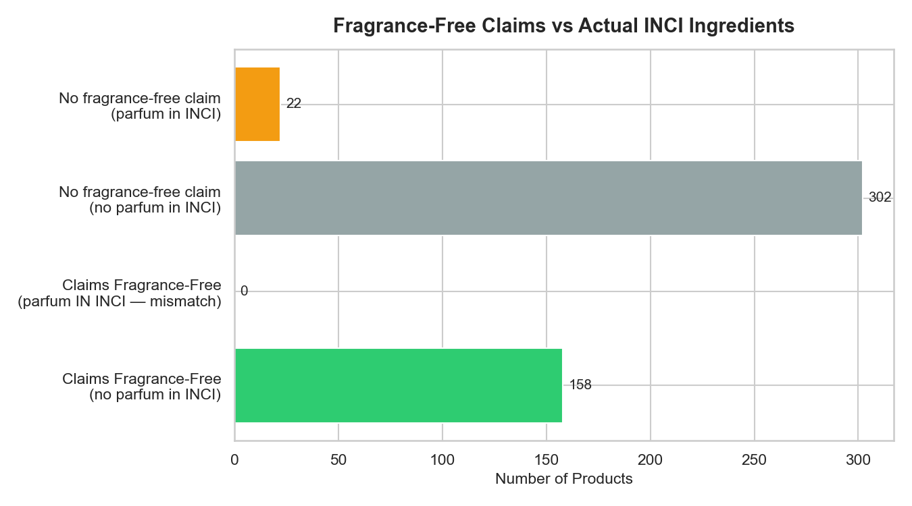
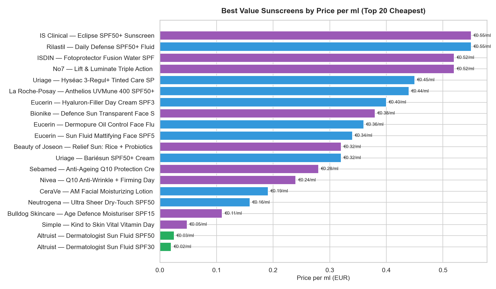

# 🧴 Skincare Market Analysis

**What does a higher price actually buy you in skincare?**
An end-to-end data project on **482 skincare products from 210 brands across 27 countries**: collecting and enriching the data through the Open Beauty Facts API, testing the findings statistically, building an ingredient-based **dupe finder** (TF-IDF + cosine similarity) and a **plain-English skincare assistant** (retrieval-augmented generation with open-source LLMs), all in one interactive Streamlit dashboard.

**Tools:** Python · pandas · NumPy · SciPy · matplotlib · seaborn · Plotly · Streamlit · REST APIs · TF-IDF / cosine similarity · RAG · open-source LLMs (Llama 3.1 via Groq, Ollama) · fuzzy matching (difflib)

---

## 💬 Skincare assistant: ask in plain English

Type a request like *"fragrance-free moisturiser for sensitive skin under €20"* or *"cheaper alternative to SkinCeuticals C E Ferulic"* and the assistant answers with matching products from the dataset.

It uses **retrieval-augmented generation (RAG)**, the same pattern as my [PDF chatbot](https://github.com/Aparna2423/PDF_Chatbot), applied to structured product data (`assistant.py`):

```
question ──► 1. understand: price limit, product type, skin type, claims, ingredients, "dupe" intent
         ──► 2. retrieve:   filter products + rank by TF-IDF text similarity  (dupe questions → dupe finder)
         ──► 3. generate:   open-source LLM writes the answer using ONLY the retrieved products
```

- **Grounded:** the model only sees the retrieved products and is told not to invent any, so answers can't recommend products that aren't in the data. Each answer shows the products it's based on.
- **Free, open-source models:** Llama 3.1 via Groq's free tier in the live app, or a local [Ollama](https://ollama.com) model on your own computer. With no model available, it still returns the matching products.
- **Smart fallbacks:** if nothing matches every constraint, it relaxes the least important ones and says so. If a product has no close ingredient twin, it says that too.

| Example request | What it finds |
|---|---|
| Fragrance-free moisturiser for sensitive skin under €20 | ACO, Sebamed, CeraVe sensitive-skin creams (€9–14) |
| Vegan serum with niacinamide for oily skin | The Inkey List, Etat Pur, The Ordinary niacinamide serums (€6–12) |
| Cheaper alternative to SkinCeuticals C E Ferulic | Paula's Choice C15 Super Booster: 92 % match, 50 % cheaper per ml |
| Retinol serum under €30 | The Inkey List, CeraVe, L'Oréal retinol serums (€10–28) |

---

## 💡 Dupe finder: cheaper products with similar ingredients

Pick any product and the dashboard finds the products with the most similar ingredient profile, cheaper per ml and of the same type.

**Example:** for *SkinCeuticals C E Ferulic* (€5.67/ml), the top match is *Paula's Choice C15 Super Booster*: **92 % ingredient match, 50 % cheaper per ml**. It shares vitamin C, vitamin E and ferulic acid, and is a widely cited real-world dupe. The algorithm found it from ingredient data alone.

**How it works** (`dupe_finder.py`):
1. Each product becomes a weighted "bag of ingredients": key ingredients ×2, partial INCI ×1, skin concerns ×0.5.
2. Ingredient names are normalised and synonyms merged (*sodium hyaluronate* → *hyaluronic acid*, *tocopherol* → *vitamin E*, concentrations stripped).
3. **TF-IDF** weighting makes rare actives (retinol, niacinamide) count more than near-universal ingredients (water, glycerin).
4. **Cosine similarity** between product vectors gives a 0–100 % match score.

**55 % of products (263 of 482)** have at least one cheaper alternative of the same type. A similar ingredient list isn't an identical formula, though: concentrations and textures can differ.

---

## Key findings

### 1. Price per ml varies roughly 10× between segments
Median price per ml ranges from **€0.22 (Budget)** to **€2.23 (Clinical)**. Luxury (€1.83) and Mid-range (€1.70) sit near the top, while Pharmacy products stay close to budget levels at €0.30/ml.


### 2. …but per ml, you aren't paying for better ratings
Average ratings only span **4.35 to 4.70** across segments: Budget averages 4.40 and Luxury 4.68, so paying about 8× more per ml buys roughly a quarter of a star. Mid-range products are rated *lowest* (4.35), despite being among the most expensive per ml.

**Statistical tests** (rank-based, because ratings are bunched and prices skewed):

| Test | Result | Meaning |
|---|---|---|
| Spearman: price **per ml** vs rating | ρ = 0.09, p ≈ 0.06 | No meaningful relationship |
| Spearman: **absolute** price vs rating | ρ = 0.40, p < 0.001 | Moderate positive link: expensive products rate somewhat higher (often in smaller sizes) |
| Kruskal–Wallis: rating by segment | H = 153, p < 0.001, ε² = 0.31 | Segments differ, but the whole scale spans about one star |

**Conclusion:** luxury products rate slightly higher, but the extra cost per ml isn't reflected in ratings, which is the motivation for the dupe finder.


### 3. "Fragrance-free" claims hold up
I cross-checked every product's marketing claims against its INCI ingredient list. **None of the 158 products claiming to be fragrance-free list parfum/fragrance** in their ingredients. Meanwhile, 22 products that make no claim do contain fragrance.



### 4. Nordic brands cost more, French brands rate higher
Nordic brands (n = 38) have a median price of **€46.50**, compared with **€35** for French brands (n = 107). Yet French brands score slightly higher (median rating 4.6 vs 4.5). French brands focus heavily on moisturisers and serums.


### 5. Best-value sunscreens
A ranking of the 20 cheapest sunscreens by price per ml, a practical shortlist for value-conscious buyers.



---

## Interactive dashboard

`skincare_dashboard.py` is a Streamlit app with an **Assistant** chat tab, a **Dupe Finder** tab and five tabs for exploring the data. The public version runs on a **200-product sample** (`demo_sample.xlsx`, covering all 15 most-listed brands and every segment). The full dataset is only used locally:

- **Dupe finder:** pick a product, get cheaper similar alternatives with match score, savings and shared ingredients
- **Filters:** searchable brand and key-ingredient dropdowns, product type, segment, skin concern and type, brand country, price range, fragrance-free and alcohol-free toggles
- **Compare:** segment mix, top product types, skin concern × segment heatmap, brands by country
- **Price analysis:** price distribution, median price by type, price vs rating, best value per ml
- **Ratings:** average by segment, top-rated products (min. 5,000 reviews), most-reviewed brands
- **Ingredients:** fragrance claims vs INCI, most common key ingredients, vegan/cruelty-free/organic claims
- **Product table:** sortable, filterable, downloadable as CSV

```bash
pip install -r requirements.txt
streamlit run skincare_dashboard.py
```
For AI-written answers, either run [Ollama](https://ollama.com) locally (`ollama pull qwen:4b`), or set a free Groq API key as `GROQ_API_KEY` (as an environment variable, or in `.streamlit/secrets.toml`, which is git-ignored).
The app opens at `http://localhost:8501`. It expects `Skincare_Products_Complete.xlsx` (not included, see the note below) in the same folder.

---

## Data pipeline
> **Note:** the dataset itself is kept private and isn't included in this repository. The code, analysis and charts are shared. To run the notebook or dashboard, use your own data with the same columns (Brand, Product Name, Product Type, Segment, Skin Concern, Free-From / Claims, Price (approx), Size, Avg Rating, INCI (partial), Country of Brand).


| Step | File | What it does |
|---|---|---|
| Collect | `main.py` | Pulls moisturiser data from the Open Beauty Facts API → `moisturizers.csv` |
| Dataset | `Skincare_Products_Complete.xlsx` | Main dataset: 482 products with brand, type, segment, skin concern, claims, price, size, rating and partial INCI |
| Clean | `DataCleaning.py` | Cleans and standardises the dataset → `moisturizer_data.csv` |
| Enrich | notebook, part 2 | Looks up full ingredient lists via the Open Beauty Facts API, with fuzzy matching on product names as a fallback → `Skincare_Products_Complete_updated.xlsx` |
| Parse | notebook, part 2 | Splits ingredient lists and flags fragrance, alcohol, niacinamide and silicones → `skincare_parsed.xlsx` |
| Analyse | `skincare_market_analysis.ipynb` | Charts and findings (part 1) |
| Test | notebook, part 3 | Spearman correlation and Kruskal–Wallis tests of price vs rating |
| Recommend | `dupe_finder.py`, notebook part 4 | Ingredient TF-IDF + cosine similarity dupe finder |
| Assist | `assistant.py` | Plain-English product assistant (RAG: rule-based parsing + TF-IDF retrieval + open-source LLM) |
| Present | `skincare_dashboard.py` | Interactive Streamlit dashboard |

## Limitations
- Prices are approximate retail prices in EUR, and ratings come from aggregated review data, so treat them as indicative.
- The fragrance check uses a *partial* INCI list, so fragrance listed later in an ingredient list could be missed.
- The dupe finder works on key ingredients plus a *partial* INCI list, so it matches on main actives, not complete formulas.
- Open Beauty Facts is community-maintained: the exact-name search matched 52 products, and fuzzy matching recovered another 80, giving **132 of 482 (27%)** with full ingredient data. Ingredient-level findings therefore cover a subset of the dataset.

## Next steps
- Replace TF-IDF retrieval with sentence embeddings for better understanding of synonyms ("hydrating" ≈ "moisturising")
- Evaluate the assistant on a set of test questions (retrieval precision)
- Use full INCI lists in the dupe finder once ingredient coverage improves (barcode lookups)
- Model which product attributes best predict rating
